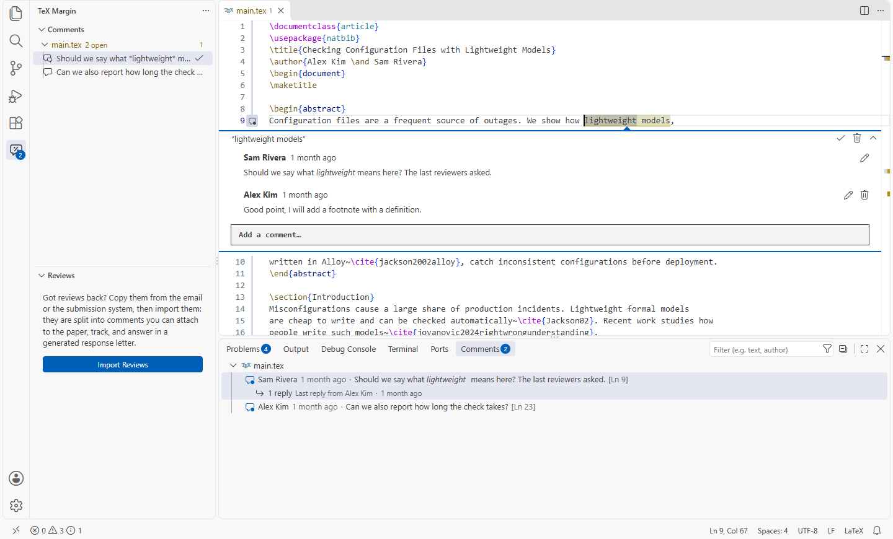

# TeX Margin

Overleaf-style review comments and research companion for LaTeX in VS Code. TeX Margin lives on the margin of your editor as a seamless companion for review and research. 




> [Note]
> I've been writing LaTeX in VS Code for quite a while now. There are plenty of great tools and extensions out there and I am using them too. Howver, some issues I couldn't resolve easily. I wanted something lightweight that could act as a review companion right on the margin of my editor. Nothing I found quite hit the mark or felt as smooth as I wanted. 

> [IMPORTANT]
> I built this mostly for my own research workflow (mostly DBLP and CrossRef). Therefore, I didn't make the effort to adding PubMed, CORE, or others. If you'd love to see another source supported, PRs are very welcome!


> [WARNING]
> Parts of the implementation and documentation were generated with AI and I haven't reviewed or validated, so there may be bugs. Between research and writing, I mostly fix issues as I encuonter them. If you run into anything unusual, please open an issue!

## Features

- **Inline threads**: select text, then press `⌘⌥M` / `Ctrl+Alt+M`, right-click → *Add Comment*, or click the gutter **+**. A multi-line Markdown comment box opens in place. Threads support replies, inline editing, resolve/reopen and delete.
- **Highlights**: commented text is highlighted, with an overview-ruler mark. Hover over it to see the thread, with action links.
- **Sidebar** (TeX Margin icon in the activity bar): comments grouped by file, in document order, with line numbers. Click one to jump to it. Moving the cursor into commented text selects its thread in the sidebar. The badge shows the number of open comments.
- **Multiple machines**: commit `.texmargin/comments.json` together with your `.tex` files.
- **Detached comments** are never deleted silently. They show as *detached*. Select the right text and use *Re-attach*.
- **Tidy BibTeX** and **Update Entry Metadata** (DBLP, Crossref, OpenAlex), both with a diff preview.
- **Citation checks** in the Problems panel: missing and unused entries, duplicates, retracted papers, preprints that have been published.
- **Responding to reviewers**: import reviews, attach each comment to the paper, track what is addressed, and generate the response letter (see below).

## Tidy BibTeX

Powered by [bibtex-tidy](https://github.com/FlamingTempura/bibtex-tidy): consistent spacing and indentation, sorted entries and fields, merged duplicates, removed fields, and more.

- **Tidy BibTeX Fil** (editor title bar, right-click in a `.bib` file or in the Explorer): pick what to do, then the result opens as a diff. Nothing has changed yet. From the title bar:
  - **✓ Apply** all changes at once (saved; *Undo* restores the original), or **✕** discard.
  - **⇄ Review one by one**: the tidied text goes into the file, unsaved, next to the original. Hover a change and click the arrow between the sides to revert it, or edit the right side. Then
    **✓ Keep** (saves) or **Discard** all.
- **Format Document** on a `.bib` file runs bibtex-tidy with your settings.
- Warnings (duplicates, missing keys) are listed in the *TeX Margin: BibTeX Tidy* output.
- A `{` that is never closed is reported with its line. bibtex-tidy itself would silently drop everything after it.
- Comments on a `.bib` file follow entries that tidying moves.

## Update Entry Metadata

Put the cursor in a BibTeX entry and run **Update Entry Metadata…** (right-click, the lightbulb / `Ctrl+.`, or the command palette). TeX Margin searches the sources in order (default: arXiv, DBLP, Crossref, then OpenAlex) and uses the first confident match:

- A matching DOI decides, unless the title says it is a different paper. Otherwise the
  **title** must match closely and the **first author** must be among the authors.
-An arXiv entry is updated to its conference or journal version, also when the entry has the arXiv DOI.
- Preprints published under a revised title are found two ways. First, the arXiv record, when
  its authors added the published DOI there (an exact link). Second, the authors' publication
  list on DBLP. A paper found there counts only if the author list is identical, it appeared the same year or up to two years later, and the titles share most words. You always confirm such a match; it is never applied automatically.
- Several plausible matches: you pick, or try the next source.

The result opens in the same preview as *Tidy BibTeX* (apply all, or review field by field). The merge **fixes and fills in** fields:
- Your **citation key** and **fields only you have** (`note`, `file`, `keywords`, …) are kept.
- Values that mean the same (`{BERT}` vs `BERT`, `Vaswani, A.` vs `Ashish Vaswani`, `1-10` vs `1--10`) keep your version.
- Fields that no longer fit go: `journal = {arXiv preprint …}` when the paper is now an `@inproceedings`, `journal` vs `booktitle` after a type change.
- New and changed fields follow the entry's style: indentation, alignment, `Last, First` names, quotes vs braces. Unchanged fields stay byte-for-byte as they were.


API keys are stored in VS Code's secret storage, never in `settings.json`: run **TeX Margin: Set Metadata API Key…**. Titles and DOIs of the entries you update are sent to the sources you enable.

## Citation checks

Kept up to date in the Problems panel as you write (offline):

| Problem | Where | Quick fix |
|---|---|---|
| `\cite{key}` without a BibTeX entry | the `\cite` | *Change to "…"* when a key is close (typo, wrong case) |
| Entry never cited | the `.bib` entry (faded) | *Remove unused entry*, or *Remove all unused entries…* |
| Key defined twice | the second definition | *Remove this definition* |
| Same paper under two keys (same DOI, or same title, first author and year) | both entries | *Keep A, merge B into it*: fills in A's missing fields from B, rewrites every `\cite{B}`, removes B |


On demand (online):
- Check Cited Papers for Retractions: asks Crossref about each cited entry's DOI. Crossref includes the Retraction Watch database. Retractions show as errors, expressions of concern as warnings, and corrections as information, each linking to the notice.
- Find Published Versions of Preprints… (right-click a `.bib` file): runs *Update Entry Metadata* for every arXiv-style entry and shows all published versions in one preview diff. Review them one by one, or apply all. Entries with several possible matches are listed, so you can update them one at a time.

## Responding to reviewers

1. **Import.** Copy the reviews from the email or the submission system (EasyChair, OpenReview, journal systems) and click **+** in the *Reviews* view (or run **TeX Margin: Import Reviews…**). Name the round, and choose the version you submitted: your current files, or a git commit or tag. The reviews are split into reviewers and numbered comments, in `reviews/round-1.md`.
2. **Fix the split** if needed. It is a plain Markdown file:

   ```markdown
   ## Reviewer 1
   ### [ ] R1.2 <!-- comment:k3x9 -->
   > 1. The evaluation is too small.
   We now evaluate on 250 models (Section~4).
   ```

The reviewer's text is the `>` quote. Write your response under it, in LaTeX. Commit the file with the paper; co-authors can edit it too.

3. **Attach** a comment to the paper: select the text in the `.tex` file and click 📌 next to the comment in the *Reviews* view (or right-click → *Attach Review Comment to Selection*). It becomes a TeX Margin comment, which stays in place while you revise.
4. **Track** progress: ✓ marks a comment addressed (and resolves its margin comment). Each reviewer shows how many are done. *Show Changes Since Submission* opens a diff of the paper around a comment.
5. **Generate the response letter** (title bar of the *Reviews* view): `round-1-response.tex`, with each comment, your response, and, for comments attached to a paragraph that changed since submission, the revised text with its line number. Open comments are marked as red TODOs. Regenerating shows a diff first. Edit responses in the `.md`, not in the letter.

The submitted version is stored as git blob hashes in the `.md` file. The texts themselves come
from git when you picked a commit. When you picked your current files, they come from snapshots in
VS Code's private storage on your machine.

## How anchoring works

Each comment is a span of character offsets `[start, end)`. Each file stores the **git blob hash** of the exact text those offsets refer to.

| Layer | When | How |
|---|---|---|
| 1. Live tracking | Edits in VS Code | Every edit moves every span, like Overleaf's OT ranges. Large replacements (a reload from disk, a formatter, pasting over a block) are first split into fine-grained edits with a diff. |
| 2. Hash check | A file is opened or loaded | A matching hash means the offsets are exact. |
| 3. Diff replay | The hash doesn't match (the file changed while VS Code wasn't watching) | Recover the old text from memory, from the saved file (when VS Code restores unsaved changes), from a snapshot in private extension storage (uncommitted states), or from git (`git cat-file blob <hash>`, any committed version, for example from your other machine). Diff old → new and map every span through it. |
| 4. Search | No old text anywhere | Exact quote nearest the old position, then a fuzzy match (Bitap, ≥ 75 % similar). Otherwise the comment is marked detached. |

Edge behaviour:
- Typing right before or after a comment doesn't extend it. Typing inside grows it.
- Deleting the commented text collapses the comment to a point (💬). Undo brings it back.
- A comment whose text was moved elsewhere is found again.

## Using it on Multiple Machines

1. Comment on machine A, then commit `.texmargin/comments.json` with your `.tex` files and push.
2. Pull on machine B. TeX Margin notices that `comments.json` changed and reloads it, even while VS Code is open. 

`comments.json` always describes the files **as saved on disk**, never an unsaved buffer. So the `.tex` files and `comments.json` in a commit always match, and machine B gets exact offsets (layer 2). A comment on text you haven't saved yet is stored as a point with its quote. It becomes whole again once the text is saved.

If machine B has edits of its own when it pulls, layer 3 maps the offsets. It gets the committed version from git and diffs it against B's text. If both machines changed comments without pulling in between, `comments.json` can conflict like any file. Comments stay read-only until the conflict is resolved.


## Settings

- `texMargin.author`: the name on your comments. By default, `git config user.name`, then your OS user name.
- `texMargin.languages`: the languages with the inline comment UI. Default: LaTeX, TeX, BibTeX.
- `texMargin.bibtexTidy.options`: options passed to bibtex-tidy, named like its
  [CLI options](https://flamingtempura.github.io/bibtex-tidy/) in camelCase, for example `{ "sort": true, "merge": "combine", "omit": ["abstract", "file"], "sortFields": true }`.  Indentation follows the editor unless `space` or `tab` is set.
- `texMargin.bibtexTidy.chooseEachTime`: pick the steps each time you tidy (default on).
- `texMargin.bibtexTidy.formatter`: provide *Format Document* for BibTeX (default on). Turn it off if another extension should format `.bib` files.
- `texMargin.bibUpdate.sources`: the metadata sources, in order.
- `texMargin.bibUpdate.email`: your email for Crossref's polite pool. Sent only to Crossref.
- `texMargin.bibUpdate.keepFields`: fields an update never changes, e.g. `["title"]`; `type` keeps the entry type.
- `texMargin.bibUpdate.skipFields`: fields never taken from a source. Default: dblp's bookkeeping (`timestamp`, `biburl`, `bibsource`), proceedings `editor`s, and Crossref's non-standard `collection`. Remove a field to take it. This setting is the only thing that drops fields, and the update message lists what was not taken.
- `texMargin.bibUpdate.skipDoiUrl`: don't take a `url` that only repeats the DOI link (default on).
- `texMargin.citations.enabled`: citation checks in the Problems panel (default on).
- `texMargin.citations.reportUnused`: report entries that are never cited (default on). Turn off if you keep one large shared bibliography.


## Known limits

- When git normalizes line endings (`core.autocrlf`), the committed blob differs from the working file. The git route can't find the old text then. Snapshots and quote search still apply.
- Changing comments on two machines without pulling in between can make `comments.json` conflict in git.
- *Format Document* with sorting enabled can collapse a comment on a `.bib` entry that moves (VS Code applies formatter edits directly). *Tidy BibTeX File…* keeps such comments on their text.
- bibtex-tidy ≥ 1.15 needs `Map.prototype.getOrInsert`, which VS Code's Node lacks. TeX Margin adds it when missing ([src/bibtidy.ts](src/bibtidy.ts)). Remove this once VS Code's Node has it.
- Metadata updates work on the entry at the cursor only, one at a time.
- Crossref's BibTeX can contain Unicode (e.g. `’`). Fine for biber/biblatex; classic BibTeX may need *Tidy BibTeX* with escaping.
- Citation checks treat the workspace as one project. Several papers in one workspace share one list of cited keys, so an entry cited only by another paper does not count as unused.
- When a document names a bibliography outside the workspace (e.g. a global library), missing keys are not reported, since they may be defined there.
- The retraction check covers entries with a Crossref DOI. Entries without a DOI and DataCite DOIs (e.g. arXiv) are listed as not checked.
- Reviews imported with "current files" as the submitted version keep that version only on the machine that imported them. Pick a git commit or tag instead, and the "revised text" quotes work for co-authors too.
- Splitting pasted reviews is a first guess (numbered points, then bullets, then paragraphs). Check it in the `.md` file.
